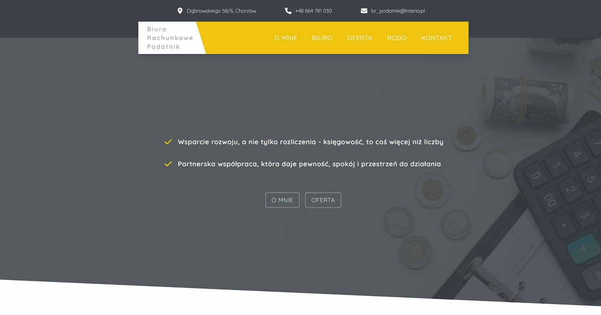

# Biuro Rachunkowe Podatnik – Accounting Office Website

**[podatnik-chorzow.pl](https://podatnik-chorzow.pl)**

## About the project

The website of my mother's accounting office, built entirely by me from start to finish: from concept, through implementation, to production deployment. The interface was created without UI component libraries: the sequential intro animation, the photo gallery that expands on hover and the animated counters are all built from scratch. The site is prepared for local SEO, with a semantic heading structure, a canonical URL and counter values already present in the server-rendered HTML. The Google map loads only after a click, so visitor data does not reach Google without their consent. The site is fully responsive.

## Technologies

**Frontend**

- **Next.js 15 (Pages Router)** – static prerendering, plus image and font optimization
- **React 19 and TypeScript** – typed components and data
- **Tailwind CSS 4** – styling and responsiveness, with a theme based on CSS variables
- **Motion** – sequential intro animation and elements animated on scroll
- **Font Awesome** – icons next to the contact details and the landing page phrases
- **Google Maps Embed** – location map loaded on demand

**Deployment**

- **Docker** – multi-stage build, Next.js standalone mode, container running without root privileges
- **Traefik** – reverse proxy with domain routing, TLS certificate and HSTS header
